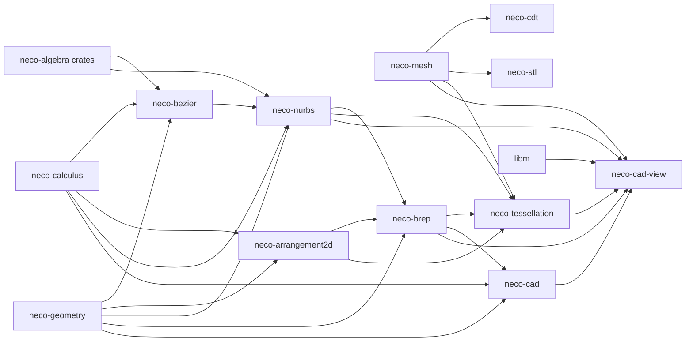

# neco-cad

[English](README.md)

`neco-cad` は、多項式や有理関数の符号条件で定めた領域 ( 代数的領域 ) から、CAD の形状データを構成する Rust のクレート群です。
領域の境界を、頂点、辺、面にあたる 0 次元、1 次元、2 次元の部分に分け、そこから境界表現、面分割、メッシュを導きます。

このクレート群は、Bézier と NURBS による曲線と曲面の表現、平面上の曲線が作る交差構造、境界表現、面分割、メッシュ、制約付き Delaunay 三角形分割、メッシュのファイル形式の変換を扱います。

## クレート構成

* [`neco-mesh`](https://crates.io/crates/neco-mesh): 検証済みの曲面メッシュと三角形メッシュの型
* [`neco-cdt`](https://crates.io/crates/neco-cdt): 検証済みの入力に対する制約付き Delaunay 三角形分割
* [`neco-stl`](https://crates.io/crates/neco-stl): 検証済みの曲面メッシュと STL 形式の相互変換
* [`neco-bezier`](https://crates.io/crates/neco-bezier): Bézier 曲線・曲面の厳密な評価、分割、包含判定
* [`neco-arrangement2d`](https://crates.io/crates/neco-arrangement2d): 平面上の曲線が作る交差構造 ( 頂点、曲線の区間、面、穴 )
* [`neco-nurbs`](https://crates.io/crates/neco-nurbs): NURBS 曲線・曲面の厳密な評価と当てはめ
* [`neco-brep`](https://crates.io/crates/neco-brep): 頂点、辺、面に分けた境界から構成する境界表現
* [`neco-cad-import`](https://crates.io/crates/neco-cad-import): メッシュや解析的なシェルを取り込み、証明付きの領域を構成する
* [`neco-tessellation`](https://crates.io/crates/neco-tessellation): 精度の証拠を伴う境界表現の面分割
* [`neco-cad`](https://crates.io/crates/neco-cad): 代数的領域を起点とする CAD エンジンの公開 API ( 各結果は、元の構築要求と導出の過程を保持する )
* [`neco-cad-view`](https://crates.io/crates/neco-cad-view): 境界表現の導出元の版を記録する表示モデルと、CPU で計算する参照投影

## 依存関係



**外部依存クレート**

* [`neco-algnum`](https://docs.rs/neco-algnum): 厳密な実代数的数
* [`neco-bigint`](https://docs.rs/neco-bigint): 厳密な整数と二進有理数の演算
* [`libm`](https://crates.io/crates/libm): `no_std` 環境向けの数学関数
* [`neco-calculus`](https://docs.rs/neco-calculus): 検証済みの評価と、根の検証結果
* [`neco-geometry`](https://docs.rs/neco-geometry): 形状、代数的領域、境界の次元ごとの分割
* [`neco-linear-exact`](https://docs.rs/neco-linear-exact): NURBS の当てはめで解く厳密な連立一次方程式
* [`neco-linear-types`](https://docs.rs/neco-linear-types): ベクトルと線形作用素の型

## CAD エンジンの処理の流れ

頂点、辺、面に分けた境界から、解析的な境界表現と、各面 ( Face ) の厳密な曲面を導出し、一つの値にまとめて返します。呼び出し側は、この値の所有権を受け取ります。

* 導出の関数: `derive_analytic_brep`
* 導出結果の型: `DerivedAnalyticBrep`
* 面の曲面の型: `FaceExactSurface`
* 曲面の被覆の型: `SurfaceCovering`

構築要求から証明付きの領域までを公開 API だけで求める場合、この導出は、次の流れの一段です。

```text
ConstructionRequest
  -> ConstructionResult::into_outputs
  -> AlgebraicRegion
  -> derive_complete_boundary
  -> derive_analytic_brep
  -> DerivedAnalyticBrep::into_adaptive_tessellation_request
  -> tessellate_adaptive
  -> AdaptiveTessellation::into_closed_oriented_surface_mesh
  -> region_from_mesh
  -> CertifiedRegion
```

各段は、受け取った値の所有権を次の段へ移します。境界表現の導出元の版 ( source revision ) は、呼び出し側が構築要求に付ける版の文字列で、面分割の結果に付いたまま残ります。一方、メッシュの識別子 ( source identity ) は、適応面分割の要求で呼び出し側が付ける、生成メッシュの名前です。メッシュから取り込み直した領域は、この識別子と導出元の版の両方を保持します。

各段を個別に呼び出すための低水準の関数も公開しています。

* 境界表現の構成: `materialize_brep`
* 適応面分割の要求の作成: `AdaptiveTessellationRequest::new`
* 平面の被覆: `plane_surface_covering`
* 単位球面の被覆: `unit_sphere_stereographic_covering`

## 現在の制限

### 曲面の被覆

厳密な曲面を導出できる面は、平面と球面です。導出に対応する形状は、平面と球面そのものと、一部の立体の面のうち平面または球面であるものに限ります。

* 一般のアフィン平面
* 一般の中心と半径を持つ球面
* 直方体の面 ( 平面 )
* 線分から成る輪郭を押し出した立体の、平面である面
* 内部が交わらない球の和集合 ( 互いに離れているもの、または外接するもの )

これ以外の曲面には、分類済みの失敗 `UnsupportedSurfaceCovering` を返します。曲面の種類のほかに、領域を定める原子式 ( atom ) の形やブール演算の種類によっても、入力は未対応になります。

* 円柱、円錐、一般の楕円体、トーラス
* 一般の回転体、有理関数の符号条件で領域を定める原子式
* 曲線によるトリムを必要とする、球どうしのブール演算

### 精度の証拠

基本の面分割 `tessellate` は、要求された弦誤差を記録するだけです。適応面分割 `tessellate_adaptive` は、次の上界を証明します。

* 弦誤差: 各三角形の辺について、パラメータ区間の全体にわたる弦誤差の上界
* 曲面残差 ( surface residual ) : 各頂点について、面が載る曲面を $f = 0$ と表す関数 $f$ の絶対値の上界。この上界は、頂点の厳密な座標を囲む二進有理数の区間で求める

これらの上界は、三角形の辺と頂点を対象とします。そのため、面の内部全体と、別に標本化した CAD の辺やトリムの曲線には、対応する上界がありません。また、曲面残差の上界が要求で指定した上限を超えた場合は、失敗 `SurfaceErrorExceeded` を返します。

### 境界の導出

境界の導出 `derive_complete_boundary` では、-3 から 3 までの整数格子の点の中から、境界の候補を求める起点となる点 ( 以下、境界の種 ) を探索します。各判定は厳密です。

境界の導出に固有の失敗 ( `BoundaryDerivationCondition` ) は、導出の処理の順に判定します。

1. 空の領域: 領域に原子式が無い場合、または原子式を組み合わせて領域を定める論理式が、正規化すると偽 ( `False` ) になる場合は `EmptyRegion`
2. 走査: 原子式を一つずつ走査し、有理関数の符号条件で定めた原子式に達した時点で `SeamUnsupported`。走査中に格子点が領域に属するかを判定できない場合は `IncompleteCoverage`
3. 特異点: 走査の後、ある原子式の格子上の零点に特異点 ( 勾配が 0 になる点 ) が含まれ、その原子式から境界の種が見つからなければ `SingularityUnsupported`
4. 境界の種: 境界の種が一つも見つからなければ `IncompleteCoverage`
5. 閉じた立体の境界: 閉じた立体 ( `RegularClosedVolume` ) の領域で、いずれかの原子式について、局所的な証明が付き、かつその原子式に由来する候補を含む境界の部分が一つも無ければ `IncompleteCoverage`

### 構築操作の対応範囲

構築要求の型は、スイープ、ロフト、フィレット、面取りを表せます。ただし現在の実装は、これらの要求に分類済みの失敗を返します。

## 関連リンク

* [ソースリポジトリ](https://github.com/barineco/neco-cad)

## ランタイム構成

既定の構成では、標準ライブラリを使います。

```toml
[dependencies]
neco-cad = "0.3"
```

既定の `std` 機能を無効にすると、動的メモリ確保だけを前提に動作するため、標準ライブラリの無い環境でも使えます。

```toml
[dependencies]
neco-cad = { version = "0.3", default-features = false }
```

`unsafe` コードは、すべてのクレートで禁止です。

## ライセンス

MIT License ( 詳細は [LICENSE](LICENSE) を参照 )
