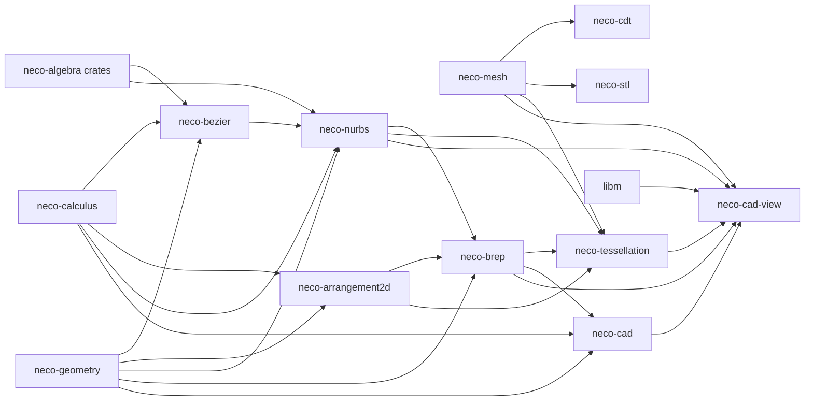

# neco-cad

[日本語](README-ja.md)

`neco-cad` is a suite of Rust crates that constructs CAD geometry data from regions defined by sign conditions of polynomials and rational functions (algebraic regions).
It splits the boundary of a region into 0-, 1-, and 2-dimensional parts, corresponding to vertices, edges, and faces, and derives boundary representations, tessellations, and meshes from them.

The suite covers Bézier and NURBS curve and surface representations, arrangements of planar curves, boundary representation, tessellation, meshes, constrained Delaunay triangulation, and mesh file format conversion.

## Crates

* [`neco-mesh`](https://crates.io/crates/neco-mesh): Validated surface and triangle mesh types.
* [`neco-cdt`](https://crates.io/crates/neco-cdt): Constrained Delaunay triangulation over validated inputs.
* [`neco-stl`](https://crates.io/crates/neco-stl): STL decoding and encoding for validated surface meshes.
* [`neco-bezier`](https://crates.io/crates/neco-bezier): Bézier curves and surfaces with exact evaluation, splitting, and containment.
* [`neco-arrangement2d`](https://crates.io/crates/neco-arrangement2d): Arrangements of planar curves: vertices, curve segments, faces, and holes.
* [`neco-nurbs`](https://crates.io/crates/neco-nurbs): NURBS curves and surfaces with exact evaluation and fitting.
* [`neco-brep`](https://crates.io/crates/neco-brep): Boundary representation built from a boundary split into vertices, edges, and faces.
* [`neco-cad-import`](https://crates.io/crates/neco-cad-import): Import of meshes and analytic shells as certified regions.
* [`neco-tessellation`](https://crates.io/crates/neco-tessellation): Tessellation of boundary representations with precision witnesses.
* [`neco-cad`](https://crates.io/crates/neco-cad): CAD engine API that starts from algebraic regions; each result retains its construction request and derivation.
* [`neco-cad-view`](https://crates.io/crates/neco-cad-view): View model that records the source revision of the boundary representation, and a CPU reference projection.

## Dependencies



**External Dependencies**

* [`neco-algnum`](https://docs.rs/neco-algnum): Exact real algebraic values.
* [`neco-bigint`](https://docs.rs/neco-bigint): Exact integer and dyadic arithmetic.
* [`libm`](https://crates.io/crates/libm): Math functions for `no_std` environments.
* [`neco-calculus`](https://docs.rs/neco-calculus): Validated evaluation and root evidence.
* [`neco-geometry`](https://docs.rs/neco-geometry): Shapes, algebraic regions, and the split of a boundary by dimension.
* [`neco-linear-exact`](https://docs.rs/neco-linear-exact): Exact linear systems used by NURBS fitting.
* [`neco-linear-types`](https://docs.rs/neco-linear-types): Vector and linear operator types.

## CAD Engine Pipeline

From the boundary split into vertices, edges, and faces, the engine derives an analytic boundary representation and the exact surface of each Face, and returns them as one value whose ownership passes to the caller.

* Derivation function: `derive_analytic_brep`
* Derived result type: `DerivedAnalyticBrep`
* Face surface type: `FaceExactSurface`
* Surface covering type: `SurfaceCovering`

When the public API alone takes a construction request to a certified region, this derivation is one stage of that processing:

```text
ConstructionRequest
  -> ConstructionResult::into_outputs
  -> AlgebraicRegion
  -> derive_complete_boundary
  -> derive_analytic_brep
  -> DerivedAnalyticBrep::into_adaptive_tessellation_request
  -> tessellate_adaptive
  -> AdaptiveTessellation::into_closed_oriented_surface_mesh
  -> region_from_mesh
  -> CertifiedRegion
```

Each stage transfers ownership of the value it receives to the next stage.
The B-Rep source revision is the revision string that the caller attaches to the construction request, and it remains attached to the tessellation result.
The mesh identity is the name of the generated mesh, which the caller supplies in the adaptive tessellation request.
The region re-imported from the mesh retains both values.

Low-level functions for calling each stage individually are also public:

* B-Rep materialization: `materialize_brep`
* Adaptive tessellation request construction: `AdaptiveTessellationRequest::new`
* Plane covering: `plane_surface_covering`
* Unit sphere covering: `unit_sphere_stereographic_covering`

## Current Limitations

### Surface Coverage

Exact surfaces can be derived for planar and spherical faces. Support is limited to planes and spheres themselves and to the planar and spherical faces of some solids:

* General affine planes
* Spheres with general centers and radii
* Faces of boxes (planar)
* Planar Faces of extrusions from profiles made of line segments
* Sphere unions with disjoint interiors (separated or externally tangent)

Other surfaces return the classified failure `UnsupportedSurfaceCovering`. Besides surface kinds, the forms of the atoms that define a region and the kinds of Boolean operations can also make an input unsupported.

* Cylinders, cones, general ellipsoids, and tori
* General revolutions, and atoms that define regions by sign conditions on rational functions
* Sphere Booleans that require curved trims

### Precision Witnesses

The basic tessellation `tessellate` only records the requested chord error. Adaptive tessellation `tessellate_adaptive` certifies the following upper bounds:

* Chord error: an upper bound over the full parameter interval of each triangle edge.
* Surface residual: for each vertex, an upper bound on the absolute value of the function $f$ that defines the face surface as $f = 0$. The bound is computed over dyadic intervals that enclose the exact vertex coordinates.

These bounds cover triangle edges and vertices. Therefore, face interiors and separately sampled CAD edge or trim curves have no corresponding bound. In addition, a surface-residual bound that exceeds the limit specified in the request returns the failure `SurfaceErrorExceeded`.

### Boundary Derivation

Boundary derivation `derive_complete_boundary` searches the integer lattice points from -3 through 3 for boundary seeds, the points from which boundary candidates are computed.
Every classification is exact.
The failures specific to boundary derivation (`BoundaryDerivationCondition`) are determined in the order of the derivation steps.

1. When the region has no atom or its normalized formula is false (`False`), the failure is `EmptyRegion`.
2. The atoms are scanned one by one. The failure `SeamUnsupported` is returned when the scan reaches an atom defined by a sign condition on a rational function. When the scan cannot classify whether a lattice point belongs to the region, the failure is `IncompleteCoverage`.
3. After the scan, if the zeros of an atom found on the lattice include a singular point (a point where the gradient is 0) and the search finds no boundary seed from that atom, the failure `SingularityUnsupported` is returned.
4. When the search finds no boundary seed at all, the failure is `IncompleteCoverage`.
5. For a closed solid (`RegularClosedVolume`), `IncompleteCoverage` is also returned when, for some atom, no part of the boundary both has a local proof and contains a candidate derived from that atom.

### Construction Operations

Construction request types can represent sweep, loft, fillet, and chamfer. The current implementation returns classified failures for these requests.

## Related Links

* [Source Repository](https://github.com/barineco/neco-cad)

## Runtime Configuration

The default configuration uses the standard library.

```toml
[dependencies]
neco-cad = "0.3"
```

Disabling the default `std` feature leaves dynamic memory allocation as the only runtime requirement, so the crates can be used in environments without the standard library.

```toml
[dependencies]
neco-cad = { version = "0.3", default-features = false }
```

Every crate forbids `unsafe` code.

## License

MIT License (See [LICENSE](LICENSE) for details).
